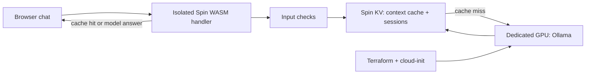

# WASM cached chatbot

A real Spin WebAssembly application that serves a small club-assistant page,
forwards questions to an Ollama inference server, and stores response cache
entries and conversation history in Spin's persistent key-value store. Keep
the request handler globally close to visitors while a dedicated GPU owns
model inference. Terraform and cloud-init are included for the GPU backend.

The cache key includes model, system instructions, conversation history, and
normalized input. An answer from one conversational context cannot silently
replace an answer from another. Entries expire after five minutes; sessions
retain the last ten turns. Administrative cache deletion requires a separate
secret. Basic input checks reject oversized messages and common instruction
override patterns; these checks are not a complete prompt-injection defense.



## Code map

| File | Responsibility |
| --- | --- |
| `src/core.mjs` | HTTP routes, guardrails, cache identity/expiry, bounded session history, and actual Ollama chat API calls. |
| `src/spin.mjs` | Binds the handler to Spin variables, persistent KV, and WASI HTTP fetch events. |
| `src/local.mjs` | Node HTTP development runner using the same handler and an in-memory store. |
| `public/index.html` | Accessible chat form, per-tab session identifier, request/error display, and conversation reset. |
| `build.mjs` | Bundles source with Spin's SDK plugin and builds an actual WASM component with `j2w`. |
| `spin.toml` | HTTP trigger, required admin secret, KV binding, and explicit allowed outbound inference host. |
| `tests/chat.test.mjs` | Thirteen handler, context separation, TTL, guardrail, session, and failure-path tests. |
| `tests/wasm-runtime.mjs` | Launches the built component under Spin and checks actual HTTP, KV cache, sessions, guardrails, and administrator routes against a loopback inference fixture. |
| `package.json`, `package-lock.json` | Exact runtime/build dependencies and reproducible npm installation. |
| `infrastructure/main.tf` | Dedicated GPU VM, explicit SSH/inference firewall, and endpoint output. |
| `infrastructure/variables.tf` | Region/model/GPU settings, public SSH key, secret password, and trusted source CIDRs. |
| `infrastructure/cloud-init.yaml.tftpl` | Installs a GPU driver, reboots, initializes Ollama, pulls and warms the model. |
| `infrastructure/.terraform.lock.hcl` | Provider checksums and version selection. |

## Test and build

Use Node.js 22+, npm, and [Spin 4](https://spinframework.dev/v4/install).

```sh
npm ci
npm test
npm run build
npm run test:wasm   # Requires spin on PATH; uses a loopback inference fixture.
# Produces dist/chatbot.wasm; the binary is generated, not committed.
spin up --variable secret_sauce='<your private cache administration secret>'
```

Open the local URL printed by Spin. Run an actual local Ollama backend with:

```sh
ollama pull qwen2.5:7b
ollama serve
```

Or point Spin at your dedicated backend:

```sh
spin up --variable ollama_url='http://<trusted-GPU-host>:11434' \
  --variable ollama_model=qwen2.5:7b \
  --variable secret_sauce='<your private cache administration secret>'
```

`npm start` runs the same application at `http://127.0.0.1:3000` with an
in-memory development store. Configure it with `OLLAMA_URL`, `OLLAMA_MODEL`,
`SECRET_SAUCE`, and optionally `PORT`. Node mode does not provide WASM isolation
or durable storage. Tests inject an HTTP fixture and need no GPU or API key.

## HTTP API

- `GET /`: chat page; `GET /healthz`: liveness.
- `POST /api/chat`: `{"message":"When is training?","fresh":false}`. Supply an
  unpredictable `X-Session-ID` (8–64 ASCII letters/digits/underscore/hyphen) to
  retain context; the page creates one per browser tab. Without it, requests
  are stateless. `fresh:true` uses neither existing history nor session writes.
- `DELETE /api/session`: clears only the session named by `X-Session-ID`.
- `DELETE /api/cache`: clears response entries only; requires
  `X-SecretSauce` equal to the configured administration secret.
- Successful answers include `X-Served-By-Cache: true` or `false`.

The example club facts are fictional. This public FAQ example is not an
authenticated service for private account data. Avoid logging prompt contents
or putting credentials in client-side JavaScript.

## Dedicated GPU infrastructure

Validation creates no resources:

```sh
terraform -chdir=infrastructure init -backend=false
terraform -chdir=infrastructure validate
terraform -chdir=infrastructure fmt -check
```

For an explicitly approved deployment, set `LINODE_TOKEN`,
`TF_VAR_root_password`, `TF_VAR_ssh_public_key`, `TF_VAR_admin_cidr`, and
`TF_VAR_inference_cidrs` (a JSON list of your runtime's trusted egress ranges)
in your environment, then run `terraform -chdir=infrastructure apply`.
There is no world-open inference rule. Keep Terraform state private; it
contains sensitive VM configuration. GPU resources incur charges.

Cloud-init installs the GPU driver and reboots once. On the next boot, the
one-shot service installs Ollama, pulls the selected model, and warms it.
Check `journalctl -u initialize-inference` and `/api/tags` before pointing the
application at the endpoint. The VM firewall binds before instance creation.
HTTP backend transport should remain within a trusted network boundary;
add a TLS reverse proxy before sending sensitive data over public networks.

The Spin manifest also supports Akamai Functions through its official `aka`
plugin. Authenticate separately, then deploy with `spin aka deploy --build`
and the same variables after reviewing the target account and costs. No cloud
resources are created by building or testing this repository.

## References

- [Original reference application](https://github.com/akamai-developers/akamai-functions-llm-chatbot)
- [Architecture walkthrough](https://developers.akamai.com/blog/edge-accelerated-ai-building-isolated-llm-chatbots-with-akamai-functions-and-dedicated-gpus/)
- [Spin JavaScript components](https://spinframework.dev/v4/javascript-components)
- [Ollama chat API](https://docs.ollama.com/api/chat)

The implementation is independently written against the documented APIs and
does not vendor the reference application's code, branding, or photographs.
